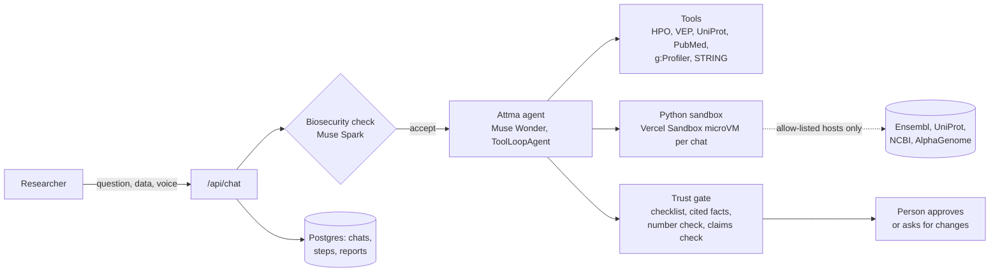

# Attma

**A research agent that turns a biology question into a reproducible, checked workflow.**

[](https://chat.attma.bio) [](https://www.youtube.com/watch?v=-DJSaB0Z2-Q) [](LICENSE) [](#meta-models)

Live: **[chat.attma.bio](https://chat.attma.bio)** · Demo: **[3-minute video](https://www.youtube.com/watch?v=-DJSaB0Z2-Q)** · Built for the Meta Global AI Developer Hackathon (2026) on Meta's Muse models.

**What was built when.** Before the hackathon this repository was a general chat app, started from the Vinta Next.js/FastAPI template (378 commits, September 2024 to January 2026). Everything that makes it a research agent was built in the hackathon window, October 26 to November 4, 2026: the agent and its tools, the rare-disease engine and its benchmark, the trust gate, the biosecurity reviewer, the Python sandbox and dictation. The [privacy guard](nextjs-frontend/lib/privacy/README.md) was added on November 5, after the deadline.

A researcher asks a question in plain language, by text or dictation, optionally with data attached (VCF, counts table, `.h5ad`, PDF). One agent plans the work, runs each step with real tools (Human Phenotype Ontology, Ensembl VEP, UniProt and AlphaFold, PubMed, g:Profiler, STRING, a Python sandbox, AlphaGenome), shows every step and its source, and answers with a citation for each claim. Reports on variants and rare-disease cases go through a **trust gate**: numbers are checked against the tool output they cite, claims are checked by a second model, and a person approves the result.

> Research use only. Attma ranks hypotheses for qualified people. It does not diagnose, and nothing it produces is medical advice.

## What it does

| Workflow                                    | What runs                                                                                                   | Typical time |
| ------------------------------------------- | ----------------------------------------------------------------------------------------------------------- | ------------ |
| Rare-disease case review                    | HPO ranking of about 12,900 diseases, Ensembl VEP (gnomAD, ClinVar, AlphaMissense, CADD), graded literature | about 1 min  |
| Single-cell atlas (PBMC 3k or your `.h5ad`) | scanpy in the sandbox: QC, Leiden, UMAP, markers, cell types, then enrichment                               | about 2 min  |
| Variant to structure                        | VEP, UniProt domains, AlphaFold confidence, PubMed                                                          | about 45 s   |
| Gene-list enrichment                        | g:Profiler (GO, Reactome, KEGG, WikiPathways), STRING                                                       | seconds      |
| Reading a report or figure                  | Muse Spark vision sub-agent                                                                                 | seconds      |

Follow-up questions in the same chat reuse its files and earlier results, like a notebook.

## How it works



- **One agent, many sources.** `lib/ai/agents/attma-agent.ts` builds an AI SDK `ToolLoopAgent` from the sources a user enables in the Sources menu. Each source adds its tools and a short playbook line to the system prompt.
- **Muse throughout.** Muse Wonder orchestrates; Muse Spark runs sub-agents (documents, literature, titles, tool-call repair, biosecurity review, claims check); Muse Image draws illustrations; Muse Voice Transcribe handles dictation in 25 languages. Models are reached through aliases in `lib/ai/providers.ts`.
- **Trust gate** (`lib/analysis/`). The agent declares a checklist, records each fact with a pointer (`ref` plus JSON path) into a captured tool result, and submits a report. The server re-reads every cited number from the captured output, a second model checks the claims, and the report waits for a person. Approval happens without another model call.
- **Privacy guard** (`lib/privacy/`). Patient identifiers (names, record and sample numbers, dates of birth, national IDs, contact details, VCF sample columns) are replaced with tokens before any model sees them. An outbound check refuses a call if a real value survived, and the researcher's browser shows the real values again. See [lib/privacy/README.md](nextjs-frontend/lib/privacy/README.md).
- **Biosecurity reviewer** (`lib/biosecurity/`). Screens the request, every Python script before it runs, and the final report. It judges intent by category, not keywords, so ordinary genetics vocabulary does not trigger a refusal.
- **Sandboxed compute** (`lib/sandbox/`). Python runs in one Vercel Sandbox microVM per chat, started from a snapshot with the scientific stack preinstalled. Outbound network is limited to an allow-list of data APIs and this app's Blob store. Figures and tables written to `outputs/` are published back to the chat.
- **Persistence.** Every step is saved as a message part, so reloading a chat shows the same workflow.

## Meta models

| Model                 | Role in Attma                                                                                                                     |
| --------------------- | --------------------------------------------------------------------------------------------------------------------------------- |
| Muse Wonder 1.0       | The agent: plans the workflow, chooses tools, writes the report                                                                   |
| Muse Spark 1.3        | Sub-agents (documents, figures, literature grading), chat titles, tool-call repair, the claims check and the biosecurity reviewer |
| Muse Voice Transcribe | Dictation in 25 languages                                                                                                         |
| Muse Image 1.0        | Illustrations                                                                                                                     |
| Muse search grounding | Cited web search                                                                                                                  |

Model roles live in `nextjs-frontend/lib/ai/providers.ts`. While the Meta Model API refuses calls for a billing reason, each call is retried on OpenAI (`gpt-4o` for Wonder, `gpt-4o-mini` for Spark), and the step badges name the model that actually answered.

## Benchmark

`nextjs-frontend/scripts/rare-disease-eval/` measures the rare-disease tools on 200 solved, published cases from the GA4GH phenopacket-store, one per gene, with a separate 150-case tuning set for method choices.

HPO's own annotations were partly curated from these case reports, so 169 of the 200 test cases could be matched against knowledge built from themselves. The **held-out** run rebuilds the index without those annotations. It is the number we quote:

| Held-out, 200 cases                                                | Result          |
| ------------------------------------------------------------------ | --------------- |
| Causal variant among 20 candidates, top-1 / top-5, with phenotypes | **50.5% / 63%** |
| Same, variant evidence only                                        | 0% / 32%        |
| Causal gene from phenotypes alone, top-10                          | 38%             |

Method, leakage control, full-release numbers and how to reproduce them: [scripts/rare-disease-eval/README.md](nextjs-frontend/scripts/rare-disease-eval/README.md). These numbers describe ranking quality on published cases, not diagnostic accuracy.

## Limits

- **Research use only.** It ranks hypotheses for qualified people and never diagnoses.
- **The benchmark measures ranking on published cases**, not accuracy on new patients. Its held-out numbers are the ones to quote.
- **Privacy guard, first tier:** names written without a cue (`Patient:`, `Mr.`) are not caught yet, and images and PDFs reach a model unscanned. The reply says so; [the guard's README](nextjs-frontend/lib/privacy/README.md) has the measured numbers.
- **The biosecurity reviewer is a model.** It fails closed when unavailable, and its policy is tested so ordinary research is not blocked, but it is not a guarantee.
- **API keys in the sandbox** (AlphaGenome) are visible to code running there, until credential injection is available.

## Run it locally

Requirements: Node.js 22+, [Bun](https://bun.sh) 1.3.13, a Postgres database, and a Meta Muse API key.

```bash
cd nextjs-frontend
bun install
cp .env.example .env.local      # then fill in the values below
bun run db:migrate
bun dev                         # http://localhost:3000
```

| Variable                                                  | Needed for                                                                                  |
| --------------------------------------------------------- | ------------------------------------------------------------------------------------------- |
| `META_MODEL_API_KEY`                                      | All Muse models. Without it the model aliases fall back to OpenAI (`OPENAI_API_KEY`).       |
| `POSTGRES_URL`                                            | Chats, users and reports (Drizzle ORM)                                                      |
| `AUTH_SECRET`, `GOOGLE_CLIENT_ID`, `GOOGLE_CLIENT_SECRET` | Sign-in with Auth.js: Google or email and password. All three are required at startup.      |
| `BLOB_READ_WRITE_TOKEN`                                   | File uploads and published figures (Vercel Blob)                                            |
| `ATTMA_SANDBOX_SNAPSHOT`                                  | Python steps. Build one with `bun --env-file=.env.local scripts/sandbox/build-snapshot.ts`. |
| `RESEND_API_KEY`, `EMAIL_FROM`                            | Optional: password-reset and welcome emails                                                 |
| `ALPHAGENOME_API_KEY`, `PUBMED_API_KEY`                   | Optional: AlphaGenome variant-effect prediction, faster PubMed                              |

For local sign-in, also set `AUTH_URL=http://localhost:3000` and `AUTH_TRUST_HOST=true`. A local Postgres is available with `docker compose up db` from the repository root.

## Develop

Run from `nextjs-frontend/`:

| Command                              | What it does                                                                                      |
| ------------------------------------ | ------------------------------------------------------------------------------------------------- |
| `bun run lint`                       | ESLint (zero errors required)                                                                     |
| `bun run format:check`               | Prettier                                                                                          |
| `bunx tsc --noEmit -p .`             | Type check                                                                                        |
| `bun run test`                       | Jest unit tests                                                                                   |
| `bun run release-gate`               | All of the above, a dry run of the trust-gate harness and a production build (needs `.env.local`) |
| `bun run db:generate` / `db:migrate` | Write and apply Drizzle migrations                                                                |

Adding a tool touches four places: the tool in `lib/ai/tools/`, its entry and playbook line in `lib/ai/agents/attma-agent.ts`, its source in `lib/ai/connectors/catalog.ts`, and its step label in `components/chat/agent-activity.tsx`. [CLAUDE.md](CLAUDE.md) is the detailed architecture guide; [docs/HANDOFF.md](docs/HANDOFF.md) records what was built and why.

## Repository layout

```
nextjs-frontend/
  app/api/chat/route.ts        the only chat entry point: auth, agent run, streaming, persistence
  lib/ai/                      model aliases, the agent, tools and sources
  lib/analysis/                trust gate
  lib/biosecurity/             biosecurity reviewer
  lib/rare-disease/            HPO engine, VEP and PubMed clients
  lib/sandbox/                 per-chat Python sandbox and its network policy
  components/chat/             chat UI: workflow cards, step timeline, report card, dictation
  scripts/rare-disease-eval/   benchmark data, runner and results
  scripts/analysis-eval/       live harness for the trust gate
docs/
  HANDOFF.md                   decisions and history
  muse/                        the briefs Muse Code built the trust gate from, with the review log
```

## How it was built

Much of the trust gate, the biosecurity reviewer and the review fixes were written by Meta's Muse Code from the briefs in [docs/muse/](docs/muse/), each one reviewed before the next. The folder is kept as the build record.

## Security

See [SECURITY.md](SECURITY.md) to report a vulnerability.

## License

[Apache License 2.0](LICENSE). Third-party software and data, and their licenses, are listed in [NOTICE](NOTICE).
