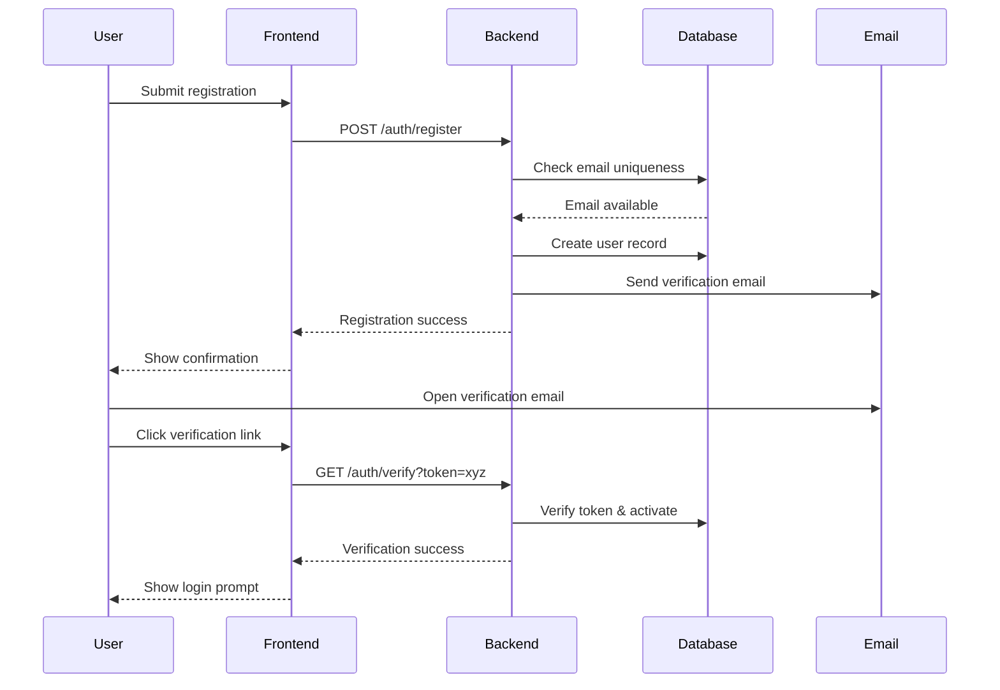
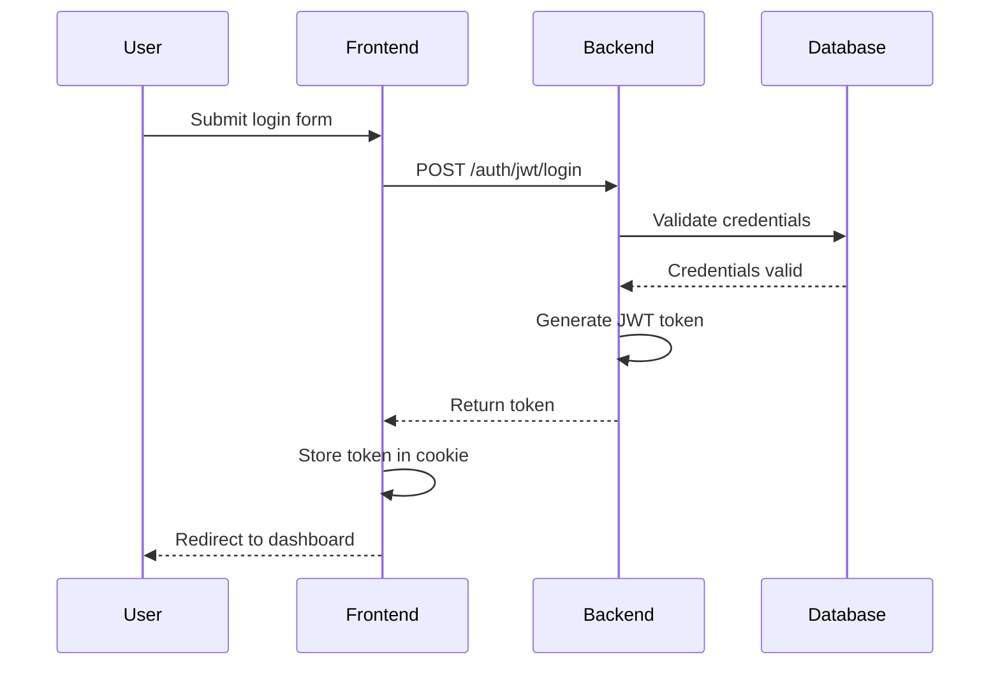

# Authentication Documentation

## Overview

This document outlines the authentication system used in the NextJS-FastAPI application with PostgreSQL (Neon) database integration. The system provides secure user authentication with JWT tokens, OAuth providers, and email verification.

## Authentication Flow

### Registration Flow

1. User submits registration form with email and password
2. Backend validates email uniqueness and password strength
3. User record is created in PostgreSQL database with:
   - Hashed password (using bcrypt)
   - Verification token
   - Account status set to inactive
4. Verification email is sent to user
5. User clicks verification link
6. Backend validates token and activates account
7. User is redirected to login page



### Login Flow

1. User submits login form with email and password
2. Backend validates credentials against database
3. If valid, JWT token is generated and returned
4. Frontend stores token in secure HTTP-only cookie
5. User is redirected to dashboard



### OAuth Flow

1. User clicks "Login with Provider" button
2. User is redirected to OAuth provider
3. User authenticates with provider
4. Provider redirects back with authorization code
5. Backend exchanges code for access token
6. Backend retrieves user profile from provider
7. Backend creates or updates user record
8. JWT token is generated and returned
9. Frontend stores token in secure cookie

### Password Reset Flow

1. User requests password reset with email
2. Backend generates reset token and stores in database
3. Email with reset link is sent to user
4. User clicks reset link and enters new password
5. Backend validates token and updates password
6. User is redirected to login page

## Token Management

### JWT Structure

```json
{
  "sub": "user_id",
  "email": "user@example.com",
  "exp": 1672531200,
  "iat": 1672444800,
  "jti": "unique_token_id"
}
```

### Token Storage

- Frontend: HTTP-only cookies with secure flag
- Backend: Token validation on each request

### Token Refresh

1. Access token expires
2. Frontend requests new token using refresh endpoint
3. Backend validates refresh token
4. If valid, new access token is issued
5. Session continues without requiring re-login

## Security Measures

### Password Handling

1. **Password Requirements**:
   - Minimum 8 characters
   - At least one uppercase letter
   - At least one lowercase letter
   - At least one number
   - At least one special character

2. **Password Storage**:
   - Passwords are hashed using bcrypt
   - Pepper is added for additional security
   - Work factor is configurable based on environment

### CSRF Protection

1. Double Submit Cookie pattern
2. CSRF tokens included in all state-changing requests
3. Origin validation on backend

### Rate Limiting

1. Login attempts are rate-limited by IP and username
2. Password reset requests are rate-limited by email
3. Account lockout after multiple failed attempts

### Session Management

1. Sessions have configurable expiry (default: 24 hours)
2. Sessions can be revoked by user (logout)
3. Sessions can be viewed and managed in user settings

## Database Schema

### Users Table

```sql
CREATE TABLE users (
  id UUID PRIMARY KEY DEFAULT uuid_generate_v4(),
  email VARCHAR(255) UNIQUE NOT NULL,
  hashed_password VARCHAR(255) NOT NULL,
  is_active BOOLEAN DEFAULT FALSE,
  is_verified BOOLEAN DEFAULT FALSE,
  verification_token VARCHAR(255),
  verification_token_expires TIMESTAMP WITH TIME ZONE,
  created_at TIMESTAMP WITH TIME ZONE DEFAULT CURRENT_TIMESTAMP,
  updated_at TIMESTAMP WITH TIME ZONE DEFAULT CURRENT_TIMESTAMP
);
```

### Sessions Table

```sql
CREATE TABLE sessions (
  id UUID PRIMARY KEY DEFAULT uuid_generate_v4(),
  user_id UUID NOT NULL REFERENCES users(id) ON DELETE CASCADE,
  refresh_token VARCHAR(255) NOT NULL,
  expires_at TIMESTAMP WITH TIME ZONE NOT NULL,
  created_at TIMESTAMP WITH TIME ZONE DEFAULT CURRENT_TIMESTAMP,
  user_agent TEXT,
  ip_address VARCHAR(45)
);
```

### OAuth Accounts Table

```sql
CREATE TABLE oauth_accounts (
  id UUID PRIMARY KEY DEFAULT uuid_generate_v4(),
  user_id UUID NOT NULL REFERENCES users(id) ON DELETE CASCADE,
  provider VARCHAR(255) NOT NULL,
  provider_account_id VARCHAR(255) NOT NULL,
  access_token TEXT,
  refresh_token TEXT,
  expires_at TIMESTAMP WITH TIME ZONE,
  created_at TIMESTAMP WITH TIME ZONE DEFAULT CURRENT_TIMESTAMP,
  updated_at TIMESTAMP WITH TIME ZONE DEFAULT CURRENT_TIMESTAMP,
  UNIQUE(provider, provider_account_id)
);
```

## Implementation Details

### Backend (FastAPI)

1. **Authentication Middleware**:
   ```python
   from fastapi import Depends, HTTPException, status
   from fastapi.security import OAuth2PasswordBearer
   from jose import JWTError, jwt
   
   oauth2_scheme = OAuth2PasswordBearer(tokenUrl="auth/jwt/login")
   
   async def get_current_user(token: str = Depends(oauth2_scheme)):
       try:
           payload = jwt.decode(
               token, 
               settings.jwt_secret, 
               algorithms=[settings.jwt_algorithm]
           )
           user_id: str = payload.get("sub")
           if user_id is None:
               raise HTTPException(status_code=status.HTTP_401_UNAUTHORIZED)
           
           # Get user from database
           user = await get_user_by_id(user_id)
           if user is None:
               raise HTTPException(status_code=status.HTTP_401_UNAUTHORIZED)
           
           return user
       except JWTError:
           raise HTTPException(status_code=status.HTTP_401_UNAUTHORIZED)
   ```

2. **Password Hashing**:
   ```python
   from passlib.context import CryptContext
   
   pwd_context = CryptContext(schemes=["bcrypt"], deprecated="auto")
   
   def verify_password(plain_password, hashed_password):
       return pwd_context.verify(plain_password, hashed_password)
   
   def get_password_hash(password):
       return pwd_context.hash(password)
   ```

### Frontend (Next.js)

1. **NextAuth.js Configuration**:
   ```typescript
   // pages/api/auth/[...nextauth].ts
   import NextAuth from "next-auth";
   import CredentialsProvider from "next-auth/providers/credentials";
   import GoogleProvider from "next-auth/providers/google";
   
   export default NextAuth({
     providers: [
       CredentialsProvider({
         name: "Credentials",
         credentials: {
           email: { label: "Email", type: "email" },
           password: { label: "Password", type: "password" },
         },
         async authorize(credentials) {
           // Call API to validate credentials
           const res = await fetch(`${process.env.NEXT_PUBLIC_API_URL}/auth/jwt/login`, {
             method: "POST",
             headers: { "Content-Type": "application/x-www-form-urlencoded" },
             body: new URLSearchParams({
               username: credentials?.email || "",
               password: credentials?.password || "",
             }),
           });
           
           const user = await res.json();
           if (res.ok && user) {
             return user;
           }
           return null;
         },
       }),
       GoogleProvider({
         clientId: process.env.GOOGLE_CLIENT_ID,
         clientSecret: process.env.GOOGLE_CLIENT_SECRET,
       }),
     ],
     callbacks: {
       async jwt({ token, user, account }) {
         if (user) {
           token.accessToken = user.access_token;
         }
         return token;
       },
       async session({ session, token }) {
         session.accessToken = token.accessToken;
         return session;
       },
     },
     pages: {
       signIn: "/auth/login",
       signOut: "/auth/logout",
       error: "/auth/error",
       verifyRequest: "/auth/verify-request",
     },
   });
   ```

2. **Auth Hooks**:
   ```typescript
   // hooks/useAuth.ts
   import { useSession, signIn, signOut } from "next-auth/react";
   
   export function useAuth() {
     const { data: session, status } = useSession();
     
     const login = async (email: string, password: string) => {
       return await signIn("credentials", {
         email,
         password,
         redirect: false,
       });
     };
     
     const logout = async () => {
       await signOut({ redirect: true, callbackUrl: "/" });
     };
     
     return {
       user: session?.user,
       isAuthenticated: status === "authenticated",
       isLoading: status === "loading",
       login,
       logout,
     };
   }
   ```

## Integration with PostgreSQL (Neon)

1. **Connection Setup**:
   ```python
   # app/database.py
   from sqlalchemy.ext.asyncio import create_async_engine, AsyncSession
   from sqlalchemy.orm import sessionmaker
   
   engine = create_async_engine(
       settings.database_url,
       echo=settings.debug,
       pool_pre_ping=True,
   )
   
   async_session = sessionmaker(
       engine, class_=AsyncSession, expire_on_commit=False
   )
   
   async def get_db():
       async with async_session() as session:
           yield session
   ```

2. **User Repository**:
   ```python
   # services/user_service.py
   from sqlalchemy import select
   from app.database import get_db
   
   async def get_user_by_email(email: str, db: AsyncSession = Depends(get_db)):
       result = await db.execute(
           select(User).where(User.email == email)
       )
       return result.scalar_one_or_none()
       
   async def create_user(user_data: UserCreate, db: AsyncSession = Depends(get_db)):
       hashed_password = get_password_hash(user_data.password)
       verification_token = generate_token()
       
       db_user = User(
           email=user_data.email,
           hashed_password=hashed_password,
           verification_token=verification_token,
           verification_token_expires=datetime.utcnow() + timedelta(hours=24)
       )
       
       db.add(db_user)
       await db.commit()
       await db.refresh(db_user)
       
       return db_user
   ```

## Troubleshooting

### Common Issues

1. **JWT Expired**:
   - Error: "Token has expired"
   - Solution: Refresh token or re-authenticate

2. **Invalid Credentials**:
   - Error: "Invalid email or password"
   - Solution: Verify credentials or reset password

3. **Account Not Verified**:
   - Error: "Email not verified"
   - Solution: Resend verification email

### Debugging Authentication

1. Check token validity: `jwt.io` debugger
2. Verify database connection
3. Check for CORS issues
4. Examine server logs for detailed errors